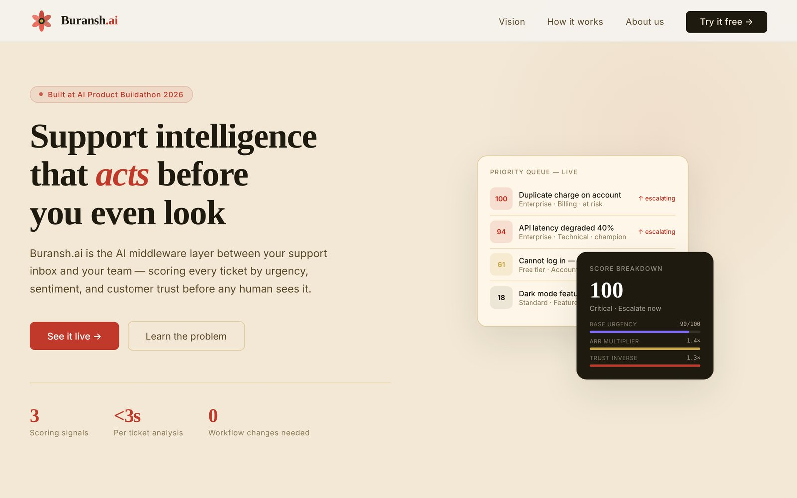
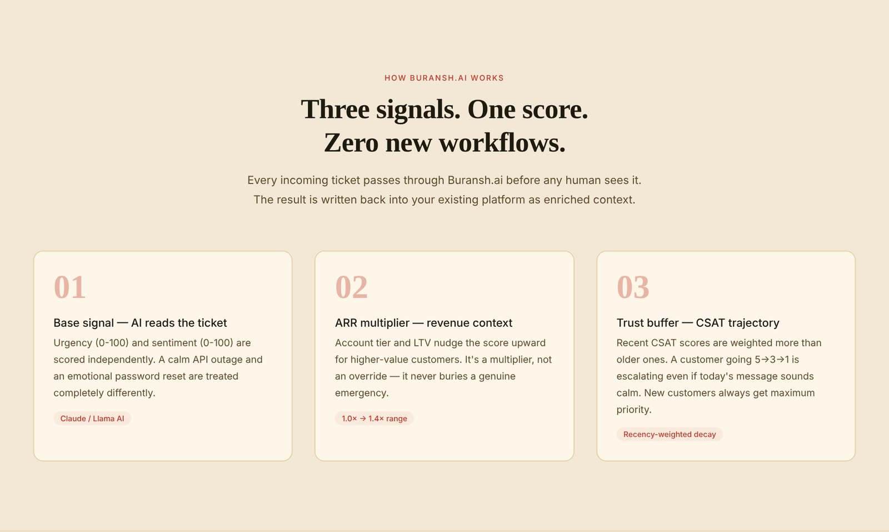
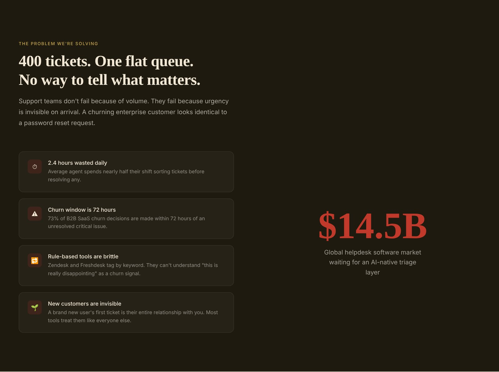
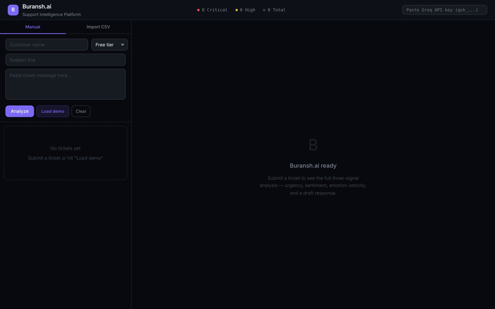

<p align="center">
  <a href="https://buransh-ai.vercel.app"></a>
</p>

<h1 align="center">Buransh.ai</h1>

<p align="center">
  <b>Support intelligence that acts before you even look.</b><br>
  An AI triage layer between your support inbox and your team. It scores every ticket by urgency,<br>
  sentiment and customer trust, so the churning enterprise customer never waits behind a password reset.
</p>

<p align="center">
  <a href="https://buransh-ai.vercel.app"><b>Live site</b></a> &nbsp;·&nbsp;
  <a href="https://buransh-ai.vercel.app/dashboard.html">Dashboard</a> &nbsp;·&nbsp;
  <a href="#run-it-yourself">Run it yourself</a>
</p>

<p align="center">
  
  
  
  
</p>

---

## The problem

Support teams don't fail because of volume. They fail because urgency is invisible when a ticket arrives. In one flat queue, an angry enterprise customer looks the same as a dark-mode feature request, and keyword rules can't tell that *"this is really disappointing"* is a churn signal.

Built in 48 hours at the **AI Product Buildathon 2026** by [The Product Space](https://theproductspace.in/).

## How it works

<p align="center"></p>

Every ticket gets three signals, combined into one score out of 100:

| Signal | What it measures |
| --- | --- |
| **1. Base signal** | The AI reads the ticket and scores urgency (0–100) and sentiment (0–100), picks a category, lists the key signals and drafts a reply. |
| **2. ARR multiplier** | The customer's plan nudges the score up, from 1.0× (free) to 1.4× (enterprise). It is a multiplier, not an override, so it never buries a real emergency. |
| **3. Trust buffer** | Recent CSAT scores count more than older ones (50 / 30 / 20 weighting). A customer going 5 → 3 → 1 is escalating even if today's message sounds calm. New customers always get maximum priority. |

**Final score = base × ARR multiplier × trust inverse**, capped at 100, then labelled critical, high, medium or low.

On top of the score, the dashboard shows:

- **Emotion velocity:** escalating, stable or de-escalating, from the CSAT trend.
- **Customer segment and churn risk:** champion, loyal, at risk, new or needs attention.
- **Incident alert:** when three or more tickets in the last hour share a category, it flags a possible incident.
- **Draft reply** for every ticket, ready to edit and send.
- **Freshdesk CSV import** to triage a whole export at once, or **Load demo** to see five sample tickets scored.

<table>
  <tr>
    <td width="50%" valign="top"><b>The problem it solves</b><br><br></td>
    <td width="50%" valign="top"><b>The triage dashboard</b><br><br></td>
  </tr>
</table>

## Tech

- **Frontend:** plain HTML, CSS and JavaScript. No framework, no build step.
- **Scoring engine:** [`scoring-engine.js`](scoring-engine.js) runs the three signals, emotion velocity, segments and churn risk in the browser.
- **AI:** one Vercel serverless function, [`api/analyze.js`](api/analyze.js), calls Groq (GPT-OSS 20B; the original build used Llama 3.1 8B Instant, which Groq retired in August 2026). The Groq key lives only in Vercel's environment variables. The function only accepts ticket prompts from this site, with a fixed model and capped size, so the key can't be used as a general AI proxy.
- **Feedback form:** Formspree.

```
index.html          landing page
dashboard.html      triage dashboard
scoring-engine.js   three-signal scoring model
api/analyze.js      serverless function that calls Groq
```

## Run it yourself

1. Fork this repo and import it in [Vercel](https://vercel.com) (no build settings needed).
2. Add `GROQ_API_KEY` in **Project → Settings → Environment Variables**. A free key from [console.groq.com](https://console.groq.com) works.
3. Deploy. If your site isn't on `buransh-ai*.vercel.app`, add your domain to `ALLOWED_ORIGIN` in `api/analyze.js`.

For local development, run `vercel dev` in the project folder and open `http://localhost:3000`.

## Team

Two people from Uttarakhand, where the Buransh (rhododendron) blooms in the hills every spring.

- **Rounak Bisht**: conceived the three-signal scoring model · [GitHub](https://github.com/RounakBisht) · [LinkedIn](https://www.linkedin.com/in/rounak-bisht-/)
- **Kartik Manral**: designed and built the dashboard and brand identity · [GitHub](https://github.com/KartikManral) · [LinkedIn](https://www.linkedin.com/in/kartik-manral-b08383249/)

## License

[MIT](LICENSE): free to use, change and share.
